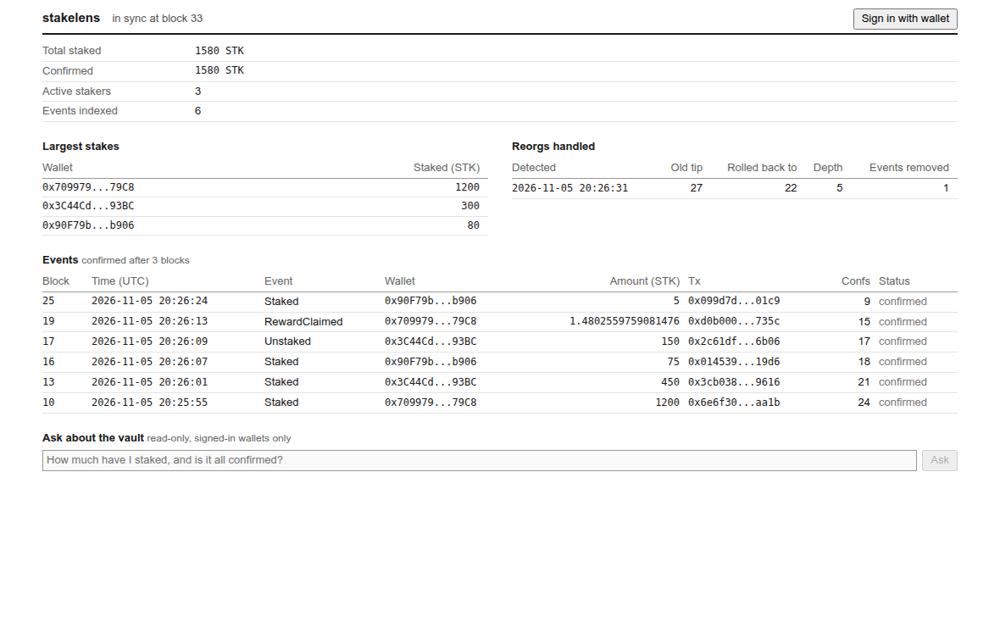

# stakelens

A backend for on-chain staking data: a Solidity staking vault, an event indexer that survives chain reorganisations and RPC outages, a crash-safe transaction queue, wallet sign-in, and a read-only assistant that answers questions from the indexed data.

**Status: MVP.** It runs end to end on a local EVM chain. It has not been deployed to a public network, and the contracts have not been audited.



## How it fits together

```
StakingVault.sol  --events-->  indexer  --writes-->  Postgres  <--reads--  FastAPI  -->  dashboard
                                                                              |
                                                               assistant (Claude + read-only tools)
```

| Part | Where | What it does |
|---|---|---|
| Contracts | [contracts/src](contracts/src) | ERC-20 token and a staking vault with pro rata rewards. No owner or admin functions. |
| Indexer | [app/indexer.py](app/indexer.py) | Follows the chain block by block and rolls back on forks. |
| RPC layer | [app/chain.py](app/chain.py) | Fails over between providers and adapts to their log query limits. |
| Reconciliation | [app/reconcile.py](app/reconcile.py) | Keeps checking that indexed balances match the contract. |
| Transaction queue | [app/txqueue.py](app/txqueue.py) | Sends transactions safely through crashes, stuck fees, and reorgs. |
| Metrics and alerts | [app/metrics.py](app/metrics.py), [ops/alerts.yml](ops/alerts.yml) | Prometheus metrics and alert rules. |
| Read layer | [app/queries.py](app/queries.py) | Derives balances from events in SQL. Used by both the API and the assistant. |
| Sign-in | [app/auth.py](app/auth.py) | Sign-In with Ethereum (EIP-4361) with single-use nonces. |
| Assistant | [app/assistant.py](app/assistant.py) | Claude with five read-only tools. It holds no keys and cannot write anything. |

## Design decisions

**Reorgs are detected, not avoided.** Waiting for finality alone would hide data for minutes and still needs a recovery path. Each new block's parent hash is compared with the stored hash of the previous block. On a mismatch, the indexer walks back to the common ancestor, deletes everything above it, records the reorg, and carries on. A fork deeper than `MAX_REORG_DEPTH` stops the indexer for an operator instead of unwinding automatically.

**A lower block number is not a reorg.** A backup node can simply be a few blocks behind, so a rollback only happens when a block hash actually disagrees. Otherwise failing over could delete good data.

**History is cheap, the head is careful.** Blocks too old to reorg are fetched in log ranges, and the range shrinks automatically to fit the provider's limit. Blocks near the head go one at a time. See [the numbers](docs/benchmarks.md).

**RPC URLs are treated as secrets.** Provider URLs usually contain an API key, so endpoints are only logged by position. A test checks this.

**The index is checked against the contract.** Balances are derived from events, so a missed event would otherwise go unnoticed. A background job compares totals and the largest wallets with the contract's state at the same confirmed block, and a mismatch raises an alert.

**Transactions are saved before they are sent.** After a crash the worker rebroadcasts the same signed bytes, and retries and fee bumps reuse the nonce, so only one version can ever be mined. Repeating an idempotency key never sends twice. One transaction per sender is in flight until confirmed, which gives up throughput for much simpler ordering. The signing key lives only in the worker, behind an interface a KMS signer can implement.

**Gas buffers are measured.** An estimate sees the current block, but a vault call that lands later can write up to three more storage slots. A percentage buffer failed on cheap calls, so the limit is 120% of the estimate plus a flat 70,000 gas, and a test checks the worst case for each action.

**Pending and confirmed are separate numbers.** The API shows new events immediately and reports both `staked` and `confirmed_staked`, so a client can decide which one to trust.

**One transaction per block.** A block's events, its hash, and the cursor commit together, so a crash cannot skip a block or duplicate events. A Postgres advisory lock stops a second indexer from racing the first.

**Logs are fetched by block hash, not number.** The node then either answers for exactly that block or returns an error. It can't return logs from a competing fork.

**Amounts are integers.** Wei is stored as `NUMERIC(78,0)` and formatted with integer maths.

**The server writes the sign-in message.** It stores the exact text the wallet signs and recovers the signer from that copy, so no client-supplied message is ever parsed. A failed attempt still uses up the nonce.

**The assistant doesn't do arithmetic.** Every figure comes from a tool backed by the same queries as the API. The tool loop is capped, questions are limited per wallet per hour, and token usage is recorded for each call.

**Principal is ring-fenced from rewards.** Rewards are paid only from tokens above `totalStaked`, so `unstake` still works if the reward pool runs dry. An invariant test checks that staked principal stays fully backed.

## Run it

Needs Docker, [uv](https://docs.astral.sh/uv/), and Python 3.12.

```sh
git clone --recurse-submodules https://github.com/thealirazadev/stakelens
cd stakelens
cp .env.example .env     # add ANTHROPIC_API_KEY to use the assistant
uv sync
make up                  # Postgres and migrations
make chain               # local chain, in its own terminal
make deploy
make indexer             # in its own terminal
make api                 # in its own terminal, then open http://localhost:8010
```

Then generate activity:

```sh
make simulate    # stakes, unstakes, and a claim from three wallets
make reorg       # stakes 999 STK, then forks the chain so that stake never happened
make check       # compares every indexed balance with the contract
```

Signing in from the dashboard needs a browser wallet such as MetaMask, connected to the local chain (`http://127.0.0.1:8545`, chain ID 31337).

To send a transaction through the queue, set `TX_SIGNER_PRIVATE_KEY` in `.env`, then:

```sh
make txworker    # in its own terminal
uv run python -m app.txworker fund-rewards --tokens 1000 --key topup-1
uv run python -m app.txworker list
```

## Deploy to Sepolia

Set these in `.env`, using a wallet that only ever holds testnet funds:

```sh
RPC_URL=your-provider-url
RPC_FALLBACK_URLS=https://ethereum-sepolia-rpc.publicnode.com
CHAIN_ID=11155111
DEPLOYER_PRIVATE_KEY=your-throwaway-key
ETHERSCAN_API_KEY=your-etherscan-key
POLL_SECONDS=6
```

```sh
make deploy
make verify        # `make verify-check` builds the submissions without sending them
make indexer
```

Sepolia makes a block every 12 seconds. A slower poll keeps the indexer inside free RPC plans.

## Tests

```sh
make test-contracts   # unit, fuzz, and invariant tests
make chain-test       # instant-mining chain for end-to-end tests, in its own terminal
make build
make test             # backend tests
make mutation         # breaks safety rules one at a time and checks that the tests notice
make benchmark        # writes docs/benchmarks.md
make alerts-check     # validates the alert rules with promtool
```

The backend tests use real Postgres. Reorg logic is covered twice: against a fake chain that can fork at exact points, and against a real EVM node with real forks. The end-to-end tests are skipped when no node is running.

[tests/test_resilience.py](tests/test_resilience.py) runs the real indexer process through `kill -9` mid-run, a full RPC outage, a failed and a rate-limited primary, a second indexer starting by mistake, a rebuild from an empty database, and a provider with a small log limit, then checks the data against the contract each time.

[tests/test_txqueue.py](tests/test_txqueue.py) runs the queue against a real node: stuck transactions, a crash on either side of the broadcast, a reorg removing a mined transaction, reverting requests, the fee cap, and a nonce taken by an outside transaction.

The assistant's tests run the real Anthropic SDK against a local stub. They check the requests and the tool loop, not the quality of the answers.

`make assistant-eval` checks the answers themselves with a real model, against the live indexed data: the exact figures for a wallet, the vault total, and the largest staker; an empty wallet; refusing to send a transaction, give investment advice, or invent an APY; and using the reorg tool. Every expected figure is read from the database at run time. On 2026-11-09, after `make simulate`, `claude-opus-5-5` (the default) and `claude-sonnet-5-5` both passed 8 of 8. With every balance still pending (`CONFIRMATIONS` set very high), the assistant also warned that a reorg could undo the stake. These runs went through the Claude Code CLI rather than an API key.

## API

| Route | Auth | |
|---|---|---|
| `GET /health` | | Sync position |
| `GET /vault/stats` | | Totals, stakers, indexer lag |
| `GET /vault/events` | | Recent events with confirmation status |
| `GET /vault/stakers` | | Largest stakes |
| `GET /vault/reorgs` | | Reorgs handled |
| `GET /vault/reconciliation` | | Latest check against the contract |
| `GET /metrics` | | Prometheus metrics read from the database |
| `GET /wallets/{address}/position` | | One wallet's balance |
| `GET /wallets/{address}/events` | | One wallet's events |
| `POST /auth/challenge` | | Get a message to sign |
| `POST /auth/verify` | | Exchange a signature for a session token |
| `GET /me/position` | Bearer | The signed-in wallet's balance |
| `POST /assistant/ask` | Bearer | Ask a question |

Interactive docs are at `/docs` while the API is running.

## Known limits

- It has only run against a local chain. Deployment and Etherscan verification are built, but have not been run on a public network.
- The transaction queue sends one transaction per sender at a time, so throughput is limited by confirmation time. Signing uses a local key. KMS support is an interface, not an implementation.
- `/metrics` is unauthenticated, so keep it behind a private network in production.
- Blocks indexed through log ranges are not all stored, so a fork deeper than `MAX_REORG_DEPTH` stops the indexer rather than unwinding.
- Blocks indexed one at a time are all kept. There is no pruning yet.
- Smart contract wallets (ERC-1271) can't sign in.
- It tracks one vault on one chain.

## License

MIT
